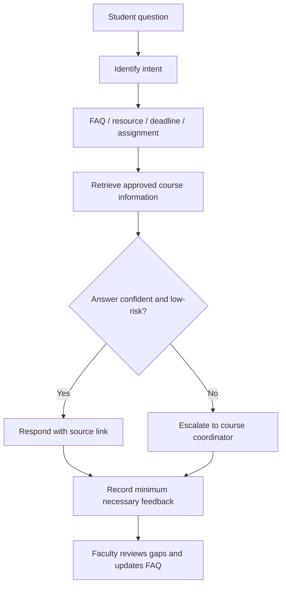

# FDP Capstone Supplement: AI Course Management, Research Integration and Responsible AI

**Project title:** An AI-Enabled Framework for Outcome-Based Smart Course Design, Automated CO-PO Mapping & Adaptive Content Generation  
**Course:** FULL STACK WEB DEVELOPMENT LAB (U23CS7L1), Academic Year 2026–27  
**Website:** https://salauddingajala.github.io/Full-Stack-Web-Development-/

## 8. AI Agent for Course Management — Case Study 13

### Purpose and scope
The proposed course-support agent helps students find approved resources, answer routine lab FAQs, view course-calendar reminders and understand assignment status. It retrieves responses from a faculty-approved knowledge base and routes uncertain, sensitive or high-stakes questions to the course coordinator. It must not independently grade students, amend attendance or make disciplinary decisions.

### Functional capabilities
- **Student queries:** answer routine questions on lab setup, experiments, tools, submission and common errors.
- **Reminders:** surface calendar events and milestones. Real email/chat reminders require an approved integration and student consent.
- **Assignment tracking:** display statuses such as Not started, In progress, Submitted and Faculty review. Status is not a grade.
- **Resource sharing:** return links to relevant experiments and official documentation.
- **FAQ support:** maintain instructor-approved responses and escalate unanswered questions.

### Flowchart

### Privacy and governance
Use authentication for private student records, role-based access, data minimisation, appropriate retention, secure integrations and clear human escalation. Never send passwords, access tokens, student marks or private records to public AI tools. The live website FAQ is currently a browser-only prototype with fixed responses; it does not call an external AI service, send reminders or store assignment data.

## 9. Research Integration — Case Study 14

### Review protocol
Search scholarly databases and publisher sites for work on AI-supported course design, Bloom's taxonomy, programming feedback, learning analytics and automated assessment. Verify each paper's exact title, authors, year, venue, DOI/official URL and availability; inspect its abstract and methods where possible. Do not cite search snippets as papers.

### Five verified recent research papers

1. **Almatrafi, O., & Johri, A. (2025).** Leveraging generative AI for course learning outcome categorization using Bloom's taxonomy. *Computers and Education: Artificial Intelligence, 8*, 100404. https://doi.org/10.1016/j.caeai.2025.100404  
   **Summary:** On a dataset of 1,000 annotated learning outcomes, the authors compared GPT-4 prompt strategies and a BERT baseline. Context-rich prompting performed best among the prompt strategies, while fine-tuned BERT performed better overall. **Application to FSWD:** use AI to propose CO/Bloom tags, then validate the cognitive demand against each actual learning task.

2. **Elkins, S., Kochmar, E., Cheung, J. C. K., & Serban, I. (2024).** How Teachers Can Use Large Language Models and Bloom's Taxonomy to Create Educational Quizzes. *Proceedings of the AAAI Conference on Artificial Intelligence, 38*(21), 23084–23091. https://doi.org/10.1609/aaai.v38i21.30353  
   **Summary:** The authors studied LLM question generation using Bloom-derived learning goals. In their experiments, generated-question-assisted quizzes did not lose quality compared with manually written quizzes, and some evaluated quality measures improved. **Application to FSWD:** use generation as a draft stage for quizzes and question papers, followed by faculty checks for technical correctness, CO coverage, marks and difficulty.

3. **Kohen-Vacs, D., Usher, M., & Jansen, M. (2025).** Integrating Generative AI into Programming Education: Student Perceptions and the Challenge of Correcting AI Errors. *International Journal of Artificial Intelligence in Education, 35*, 3166–3184. https://doi.org/10.1007/s40593-025-00496-4  
   **Summary:** Two quantitative studies examined student perceptions and their ability to correct LLM-generated code. Students generally viewed GenAI positively, but found the AI-code-correction tasks more difficult than traditional instructor-designed programming tasks. **Application to FSWD:** include controlled debugging tasks and live explanation so students demonstrate they can critically inspect code, rather than merely generate or paste it.

4. **Zhang, Z., Dong, Z., Shi, Y., Price, T., Matsuda, N., & Xu, D. (2024).** Students' Perceptions and Preferences of Generative Artificial Intelligence Feedback for Programming. *Proceedings of the AAAI Conference on Artificial Intelligence, 38*(21), 23250–23258. https://doi.org/10.1609/aaai.v38i21.30372  
   **Summary:** The study investigated ChatGPT-generated feedback for four Java lab assignments. Students generally viewed the feedback as formative and preferred feedback that included their code, reporting greater specificity and corrective usefulness; preferences about feedback tone varied. **Application to FSWD:** feedback should reference the student's actual task and tests when approved, give actionable hints, and remain subject to instructor review and data-protection safeguards.

5. **Yusuf, A., Pervin, N., Román-González, M., & Noor, N. M. (2024).** Generative AI in education and research: A systematic mapping review. *Review of Education, 12*(2), e3489. https://doi.org/10.1002/rev3.3489  
   **Summary:** This systematic mapping review analysed 407 publications and grouped research themes around applications and potential, ethical implications, perspectives, adoption and performance. It identified limited experimental evidence and gaps in the exploration of cultural dimensions and ethical concerns. **Application to FSWD:** frame AI use as a testable teaching intervention and document outcomes, limitations, student privacy and human oversight.

### Literature synthesis

Across these five papers, AI appears promising as an assistant for classifying learning outcomes, drafting Bloom-aligned quizzes, and giving formative programming feedback. However, the papers do not justify unreviewed automation. Outcome categorisation depends on prompt context and remains inferior to a strong supervised baseline in the reported study; quiz generation still needs instructor validation; and the programming studies emphasise that students need to critically evaluate generated feedback and code. The systematic mapping review places these applications within wider questions about ethics, adoption and the shortage of experimental evidence. Taken together, the literature supports a human-in-the-loop design for the FSWD portfolio: AI may draft mappings, questions and hints, while faculty check alignment and students demonstrate independent coding, debugging and explanation.

### Proposed future research direction

**Human-validated adaptive laboratory support for full-stack web development.** Pilot whether tailored practice recommendations based on quiz responses, rubric evidence and student reflection improve FSWD CO attainment. Establish baseline and post-intervention measures, use a comparison group where feasible, report limitations, minimise and anonymise data, and obtain institutional approval before collecting research data.
 
## 10. Responsible AI Use — Case Study 15

### Student AI usage policy
**Permitted with disclosure:** concept explanation, brainstorming, test-case ideas, debugging hints, accessibility suggestions, documentation editing and code review, subject to faculty directions.

**Required:** verify outputs, understand submitted code, identify AI tools and describe how they were used where required, cite factual sources and keep records of substantial AI assistance if requested.

**Prohibited:** fabricating data, attendance, tests or references; uploading personal/confidential records to unapproved services; exposing keys or credentials; plagiarism; and claiming generated work as independent work when course rules require disclosure.

### Academic integrity
Students remain responsible for correctness, originality, licensing and security of submitted work. Faculty should assess both application output and process evidence. Concerns should be reviewed fairly with evidence and an opportunity to explain. Do not rely on AI-detection scores alone as proof of misconduct.

### AI-resilient assessment strategy
1. Collect process evidence: version-control history, design choices, tests and debugging notes.
2. Conduct a short supervised practical where each student modifies a feature.
3. Use viva questions asking students to explain code, trade-offs, errors and security choices.
4. Create equivalent parameterised tasks to require individual reasoning.
5. Apply a transparent rubric covering correctness, code quality, testing, explanation and AI disclosure.
6. Keep final grading, attendance and misconduct decisions under authorised human review.

### Faculty responsibilities
Review generated materials for syllabus fit, correctness, fairness, accessibility and bias. Explain AI limitations and follow institutional rules where stricter than this proposal. This section is a course-level proposal, not a substitute for institutional policy approval.

## Implementation status
- Website sections 8–10: added to the published site's source.
- FAQ demo: implemented with fixed responses in the browser; no external AI call.
- Agent flowchart: embedded in the website and included above.
- Research: five themes and discovery links supplied; exact references still need verification.
- Reminders, student-specific assignment tracking and production AI integration require a backend, authentication, approved integrations and testing.
- Responsible AI policy is a proposed draft and must be reconciled with institutional regulations.

## Responsible AI prompt/response evidence and feedback form

The website contains a syllabus-based course-planning prompt, an Open ChatGPT link, a Copy Prompt control, a response field for the real output, and a transcript-download control. Run the prompt in the tool actually used, paste its genuine response, and attach original screenshots of that tool showing prompt and answer. The website does not generate a fake AI response.

The repository also contains `google-apps-script/CreateFswExitTicketForm.gs` and `GOOGLE-FORM-SETUP.md`. Running the Apps Script in the instructor's Google account creates the real form and response spreadsheet. Questions cover lesson mood, what was understood, what remains unclear, confidence, and “Questions, feedback or a lab milestone?”. Copy the resulting responder URL into `EXIT_TICKET_FORM_URL` in `script.js` and commit the change. Until then, the website says the form link is not yet configured.
