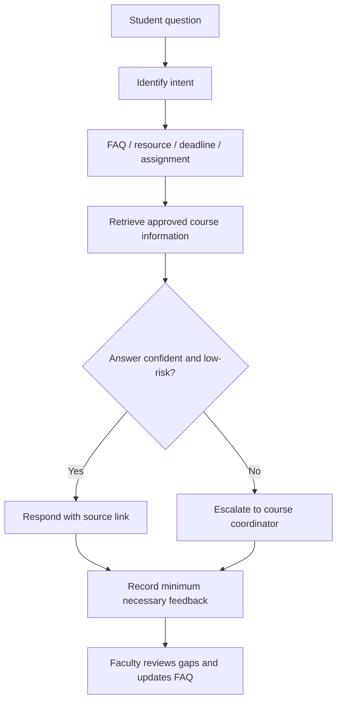

# FDP Capstone Supplement: AI Course Management, Research Integration and Responsible AI

**Project title:** An AI-Enabled Framework for Outcome-Based Smart Course Design, Automated CO-PO Mapping & Adaptive Content Generation  
**Course:** FULL STACK WEB DEVELOPMENT LAB (U23CS7L1), Academic Year 2026–27  
**Website:** https://salauddingajala.github.io/Full-Stack-Web-Development-/

## 8. AI Agent for Course Management — Case Study 13

### Purpose and scope
The proposed course-support agent helps students find approved resources, answer routine lab FAQs, view course-calendar reminders and understand assignment status. It retrieves responses from a faculty-approved knowledge base and routes uncertain, sensitive or high-stakes questions to the course coordinator. It must not independently grade students, amend attendance or make disciplinary decisions.

### Functional capabilities
- **Student queries:** answer routine questions on lab setup, experiments, tools, submission and common errors.
- **Reminders:** surface calendar events and milestones. Real email/chat reminders require an approved integration and student consent.
- **Assignment tracking:** display statuses such as Not started, In progress, Submitted and Faculty review. Status is not a grade.
- **Resource sharing:** return links to relevant experiments and official documentation.
- **FAQ support:** maintain instructor-approved responses and escalate unanswered questions.

### Flowchart

### Privacy and governance
Use authentication for private student records, role-based access, data minimisation, appropriate retention, secure integrations and clear human escalation. Never send passwords, access tokens, student marks or private records to public AI tools. The live website FAQ is currently a browser-only prototype with fixed responses; it does not call an external AI service, send reminders or store assignment data.

## 9. Research Integration — Case Study 14

### Review protocol
Search scholarly databases and publisher sites for work on AI-supported course design, Bloom's taxonomy, programming feedback, learning analytics and automated assessment. Verify each paper's exact title, authors, year, venue, DOI/official URL and availability; inspect its abstract and methods where possible. Do not cite search snippets as papers.

### Five research themes to verify
The website supplies targeted discovery searches for five themes:
1. LLM-based classification of learning objectives and questions with Bloom's taxonomy (2025 research lead).
2. Reviews or mapping studies of generative AI in higher education (2024 research lead).
3. AI-assisted feedback, debugging and programming education (2024–2025 research lead).
4. Learning analytics and course-outcome prediction (2024–2025 research lead).
5. AI-generated assessment and automated question-quality evaluation (2024–2025 research lead).

These are **research leads, not five verified citations**. Before formal submission, replace each lead with a paper whose bibliographic details and claims have been checked.

### Literature synthesis framework
For each verified paper record: (a) research problem/question, (b) method/data, (c) main findings, (d) limitations and (e) relevance to FSWD. Compare whether evidence supports AI as a planning assistant, feedback tool or analytics aid. Keep faculty validation explicit, especially for practical skills and grading.

### Proposed future research direction
**Human-validated adaptive laboratory support for full-stack web development.** Study whether formative quiz results, rubric evidence and reflections paired with tailored practice recommendations improve CO attainment. Where feasible, use pre/post assessment and a comparison group, report limitations, anonymise records and seek institutional approval before collecting research data.

## 10. Responsible AI Use — Case Study 15

### Student AI usage policy
**Permitted with disclosure:** concept explanation, brainstorming, test-case ideas, debugging hints, accessibility suggestions, documentation editing and code review, subject to faculty directions.

**Required:** verify outputs, understand submitted code, identify AI tools and describe how they were used where required, cite factual sources and keep records of substantial AI assistance if requested.

**Prohibited:** fabricating data, attendance, tests or references; uploading personal/confidential records to unapproved services; exposing keys or credentials; plagiarism; and claiming generated work as independent work when course rules require disclosure.

### Academic integrity
Students remain responsible for correctness, originality, licensing and security of submitted work. Faculty should assess both application output and process evidence. Concerns should be reviewed fairly with evidence and an opportunity to explain. Do not rely on AI-detection scores alone as proof of misconduct.

### AI-resilient assessment strategy
1. Collect process evidence: version-control history, design choices, tests and debugging notes.
2. Conduct a short supervised practical where each student modifies a feature.
3. Use viva questions asking students to explain code, trade-offs, errors and security choices.
4. Create equivalent parameterised tasks to require individual reasoning.
5. Apply a transparent rubric covering correctness, code quality, testing, explanation and AI disclosure.
6. Keep final grading, attendance and misconduct decisions under authorised human review.

### Faculty responsibilities
Review generated materials for syllabus fit, correctness, fairness, accessibility and bias. Explain AI limitations and follow institutional rules where stricter than this proposal. This section is a course-level proposal, not a substitute for institutional policy approval.

## Implementation status
- Website sections 8–10: added to the published site's source.
- FAQ demo: implemented with fixed responses in the browser; no external AI call.
- Agent flowchart: embedded in the website and included above.
- Research: five themes and discovery links supplied; exact references still need verification.
- Reminders, student-specific assignment tracking and production AI integration require a backend, authentication, approved integrations and testing.
- Responsible AI policy is a proposed draft and must be reconciled with institutional regulations.
